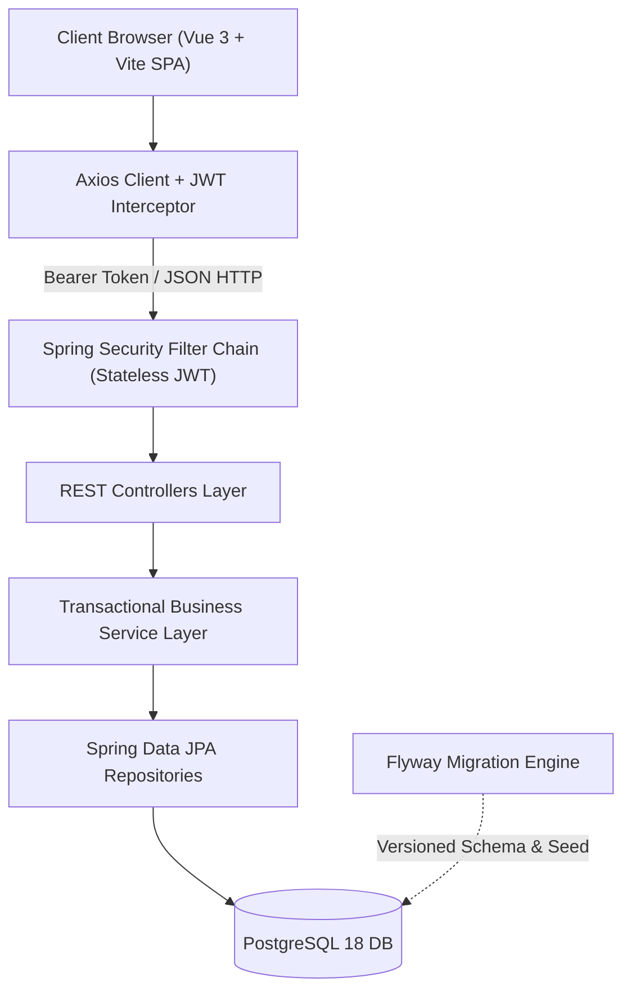

# BetArena — Virtual Prediction Market Platform

[](https://spring.io/projects/spring-boot)
[](https://www.oracle.com/java/)
[](https://vuejs.org/)
[](https://www.typescriptlang.org/)
[](https://www.postgresql.org/)
[](https://www.docker.com/)

> A modern, full-stack, enterprise-grade virtual prediction market application where users trade and wager points on real-world outcomes without financial risk. Built with a reactive multi-tier Spring Boot backend, a Vue 3 TypeScript Single Page Application (SPA), and automated containerized orchestration.

---

## Executive Summary

**BetArena** is an end-to-end prediction market web application built around a simulated virtual currency (*BetCoins*). Users can browse categorized real-world events (sports, culture, technology, internal company/institution milestones), place transactional wagers on predicted outcomes, track personal portfolio fluctuations in real time, and climb competitive leaderboards.

The project demonstrates high-standard software engineering practices: a strictly decoupled client-server architecture communicating via a typed RESTful API, stateless JWT authentication with role-based access control (RBAC), atomic database transactions for balance management, database migrations managed via Flyway, and a containerized developer experience with automated healthchecks and hot reloading.

---

## Architecture & Key Technical Decisions

The platform is designed around a multi-tier, decoupled architecture with strict separation of concerns:



### 1. Backend Architecture (Spring Boot & Java 21)
- **Multi-Layered Architecture**: Clear isolation between presentation (`controllers`), business logic (`services`), data access (`dao`), domain entities (`models`), transfer objects (`dto`), and domain exceptions (`errors`).
- **Stateless JWT Security & RBAC**:
  - Stateless session policy (`SessionCreationPolicy.STATELESS`) preventing server-side session bloat.
  - Secure token validation using HMAC-SHA256 (`jjwt` 0.13) with extracted subject claims and permission caching.
  - Role-Based Access Control distinguishing standard bettors (`ROLE_BETTOR`) from system operators (`ROLE_BOOKMAKER`).
- **Transactional Consistency & Integrity Engine**:
  - Atomic point debiting and crediting ensuring zero risk of negative balances or race conditions.
  - State machine lifecycle for events: `OPEN` (active wagering) $\rightarrow$ `CLOSED` (wagering halted, event underway) $\rightarrow$ `RESOLVED` (winning outcome declared, automated payout calculation: $\text{payout} = \text{amount} \times \text{odds}$).
- **Database Evolution with Flyway**:
  - Fully versioned database schema (`V1__init_schema.sql`) enforcing relational integrity, foreign key constraints, check constraints, and custom indexes.
  - Reproducible seed data (`V2__seed_dev_data.sql`) bootstrapping users, categories, mock events, and wager histories.

### 2. Frontend Engineering (Vue 3, TypeScript & Vite)
- **Component-Driven SPA**: Powered by Vue 3 using the Composition API and `<script setup>` syntax for concise, type-safe logic.
- **Centralized State Management**: Powered by **Pinia** for auth state (`useAuthStore`), user session persistence via `localStorage`, and reactive balance updates.
- **Robust API Layer**: Centralized Axios client configured with automatic authorization header injection and automated handling of 401 unauthenticated redirects.
- **Modern UI/UX**: Custom responsive layout featuring a dynamic lobby with category filtering, real-time odds calculation display, personal wallet history, and a protected Bookmaker console.

### 3. Containerized DevOps Workflow
- **Multi-Container Docker Compose**: Automated provisioning of four isolated services: `PostgreSQL 18`, `pgAdmin 4`, `Spring Boot Backend`, and `Vite Frontend`.
- **Healthcheck Orchestration**: Downstream containers delay startup until PostgreSQL is verified healthy (`pg_isready`), preventing connection failure cascades.
- **Developer Experience (DX)**: Volume-mounted local sources enabling instant hot-reloading for both backend (Spring DevTools) and frontend (Vite HMR) inside Docker containers.

---

## Tech Stack

| Area | Technologies |
| :--- | :--- |
| **Backend** | Java 21, Spring Boot 4.0.5, Spring Data JPA, Spring Security 6, Jakarta Validation, Lombok |
| **Security** | JSON Web Tokens (JJWT 0.13.0), BCrypt Password Encoder, Stateless Filter Chain |
| **Database** | PostgreSQL 18, Flyway DB Migration Engine, HikariCP Connection Pool |
| **Frontend** | Vue.js 3, TypeScript, Vite, Pinia 3, Vue Router 5, Axios, OXlint / ESLint |
| **DevOps & Tooling** | Docker, Docker Compose, GNU Make, pgAdmin 4 |

---

## Project Structure

```text
.
├── Makefile                      # Orchestration & lifecycle automation commands
├── docker-compose.yml            # Multi-service container orchestration
├── .env.example                  # Environment configuration template
├── docs/                         # Technical specifications and API contract documentation
│   ├── BetArena_API_Contract_v2.pdf
│   └── BetArena_Specifications_v2.pdf
├── backend/                      # Spring Boot Java 21 REST API
│   ├── Dockerfile.dev            # Development container configuration
│   ├── pom.xml                   # Maven dependencies and build setup
│   └── src/
│       ├── main/
│       │   ├── java/com/betarena/
│       │   │   ├── config/       # Security & CORS configuration
│       │   │   ├── controllers/  # REST API endpoints
│       │   │   ├── dao/          # JPA repositories
│       │   │   ├── dto/          # Typed Request & Response objects
│       │   │   ├── models/       # Relational entities
│       │   │   ├── security/     # JWT filters & token services
│       │   │   └── services/     # Business logic & transaction handlers
│       │   └── resources/
│       │       ├── application.yaml
│       │       └── db/migration/ # Flyway schema & seed scripts
│       └── test/                 # Automated test suite
└── frontend/                     # Vue 3 TypeScript Single Page Application
    ├── Dockerfile.dev            # Vite development container
    ├── package.json              # Node dependencies & npm scripts
    └── src/
        ├── api/                  # Axios REST API client modules
        ├── components/           # Reusable Vue components (NavBar, EventCard, AppFooter)
        ├── router/               # Vue Router navigation & guards
        ├── stores/               # Pinia global reactive stores
        └── views/                # Views (Lobby, EventDetail, Profile, Admin, Auth)
```

---

## Getting Started

### Prerequisites

Ensure the following tools are installed on your machine:
- [Docker Desktop](https://www.docker.com/products/docker-desktop) (v24+) & [Docker Compose](https://docs.docker.com/compose/) (v2+)
- [GNU Make](https://www.gnu.org/software/make/) (preinstalled on Linux/macOS; available via Git Bash or WSL on Windows)

---

### Quick Start (Automated with Docker & Make)

1. **Clone the repository:**
   ```bash
   git clone https://github.com/studentMeta/betarena.git
   cd betarena
   ```

2. **Initialize environment and build images:**
   ```bash
   make setup
   ```
   *(This automatically copies `.env.example` to `.env` if not present and triggers Docker Compose image builds).*

3. **Start all services:**
   ```bash
   make up
   ```

4. **Access the application:**
   - **Frontend (Web Application)**: [http://localhost:5173](http://localhost:5173)
   - **Backend REST API**: [http://localhost:8080/api](http://localhost:8080/api)
   - **pgAdmin (Database GUI)**: [http://localhost:5050](http://localhost:5050)

---

### Preconfigured Test Accounts

For demonstration and evaluation purposes, the following seeded accounts are available (Default password: `Password1!`):

| Username | Email | Assigned Role | Initial Balance | Purpose |
| :--- | :--- | :--- | :--- | :--- |
| `bookmaker` | `bookmaker@betarena.local` | `BOOKMAKER` | 0 pts | Event creation, closing & market resolution |
| `sacha` | `sacha@betarena.local` | `BETTOR` | 950 pts | Standard bettor with active and resolved bets |
| `timothy` | `timothy@betarena.local` | `BETTOR` | 800 pts | Standard bettor account |
| `jeremy` | `jeremy@betarena.local` | `BETTOR` | 850 pts | Standard bettor account |
| `alice` | `alice@betarena.local` | `BETTOR` | 5,240 pts | High-ranking leaderboard bettor |

---

### Useful CLI Commands

The included [Makefile](Makefile) provides convenient aliases for common developer operations:

```bash
make up           # Start all containerized services in background
make down         # Gracefully stop all services
make restart      # Restart all services
make logs         # Stream all combined service logs
make logs-back    # Stream Spring Boot backend logs only
make logs-front   # Stream Vite frontend logs only
make db           # Open an interactive PostgreSQL psql shell inside the container
make clean        # Remove containers while preserving database volume
make reset        # Complete hard reset (destroys containers AND volumes)
```

---

## Authors & Acknowledgments

This project was engineered as a collaborative team endeavor within the **Computer Science Department** at the **University of Namur (UNamur)**.

### Core Engineering Team:
- **Jérémy Dehaye** — *Backend Architecture, Transactional Engine & Database Modeling*
- **Timothy Lefebvre** — *Frontend Engineering, Component Design, Reactive State & UI/UX*
- **Sacha Pauwels** — *API Contract Specification, Security & Stateless JWT Authentication, Bookmaker Engine*

---

## License

This project is open-source under the [MIT License](LICENSE).
